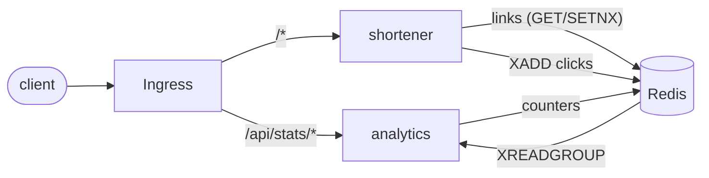

# linkpulse

[](https://github.com/piliotov/linkpulse/actions/workflows/ci.yml)
[](https://github.com/piliotov/linkpulse/actions/workflows/release.yml)

A small URL shortener with click analytics, split into two Go services and deployed to Kubernetes with Helm.
Every push to `main` runs the tests, publishes container images to GHCR and deploys the chart to a throwaway kind cluster where an end-to-end smoke test runs against it.

## Architecture



- **shortener** creates links and serves redirects. Every redirect appends a click event to a Redis stream, so a slow analytics pipeline never slows a redirect down.
- **analytics** reads the stream through a consumer group, aggregates totals, per-day counts and referrers, and serves them over HTTP. Events are acked only after the counters are written, so a crash leads to redelivery instead of lost clicks.
- Both services expose `/healthz`, `/readyz` (checks Redis) and Prometheus metrics on `/metrics`, log JSON, and shut down gracefully on SIGTERM.

## API

| Method | Path | Service | Description |
| --- | --- | --- | --- |
| POST | `/api/links` | shortener | Create a link. Body: `{"url": "...", "code": "optional"}` |
| GET | `/api/links/{code}` | shortener | Link details |
| GET | `/{code}` | shortener | 302 redirect to the target |
| GET | `/api/stats/{code}?top=10` | analytics | Totals, daily counts, top referrers |

```sh
$ curl -s -X POST localhost:8080/api/links -d '{"url":"https://go.dev","code":"go"}'
{"code":"go","url":"https://go.dev","created_at":"2026-10-21T14:03:45Z","short_url":"http://localhost:8080/go"}

$ curl -s localhost:8081/api/stats/go
{"code":"go","total":3,"daily":{"2026-10-21":3},"top_referrers":[{"host":"github.com","clicks":3}],"last_click_at":"2026-10-21T14:05:12Z"}
```

## Running locally

With Docker Compose:

```sh
make up
make smoke
```

On a local kind cluster (needs `kind`, `kubectl`, `helm`):

```sh
make kind-up
kubectl port-forward svc/linkpulse-shortener 8080 &
kubectl port-forward svc/linkpulse-analytics 8081 &
make smoke
```

Tests only need Go, Redis is replaced by [miniredis](https://github.com/alicebob/miniredis):

```sh
make test
```

## Helm chart

`deploy/helm/linkpulse` deploys both services, a Redis StatefulSet and an Ingress. Useful values:

| Value | Default | |
| --- | --- | --- |
| `imageRegistry` | `ghcr.io/piliotov` | |
| `shortener.replicas` | `2` | a PodDisruptionBudget is added when above 1 |
| `shortener.autoscaling.enabled` | `false` | HPA on CPU |
| `redis.enabled` | `true` | set `false` and `redis.externalAddr` to use a managed Redis |
| `redis.persistence.enabled` | `false` | PVC instead of emptyDir |
| `ingress.enabled` | `true` | routes `/api/stats` to analytics, everything else to shortener |

Containers run as non-root on distroless images with a read-only root filesystem and all capabilities dropped.

## CI/CD

- **CI** (`ci.yml`, every push and PR): `go vet`, `golangci-lint`, race-enabled tests with coverage, `helm lint`, kubeconform validation of the rendered manifests, hadolint, and an e2e job that builds the images, loads them into kind, installs the chart and runs `scripts/smoke.sh` plus `helm test`.
- **Release** (`release.yml`, `main` and `v*` tags): builds and pushes `ghcr.io/piliotov/linkpulse-{shortener,analytics}` tagged with the commit SHA and `latest`, then deploys exactly those images to kind, smoke tests them and checks a rolling restart. Tags also publish the chart to `oci://ghcr.io/piliotov/charts/linkpulse`.
- Dependabot keeps Go modules, base images and actions up to date.

## Layout

```
services/shortener     link API and redirects
services/analytics     stream consumer and stats API
deploy/helm/linkpulse  Helm chart
scripts/               kind deploy and smoke test
```
